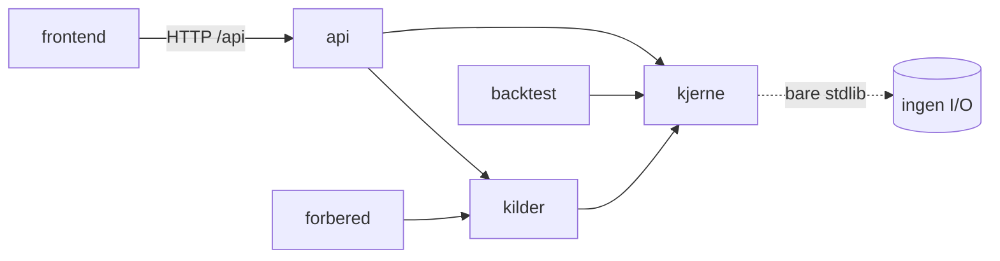
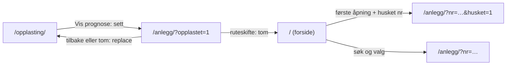
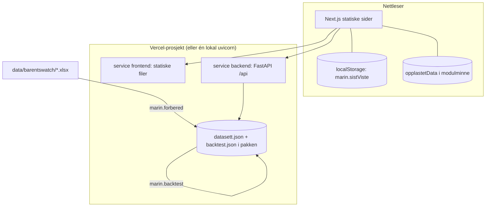

# Architecture Spine — Marin

## Design Paradigm

**Funksjonell kjerne, imperativt skall.** Reglene R1–R4, ISO-kalenderen, SK2-evalueringen og alle regelavledede tekster er rene Python-funksjoner uten I/O. Alt som leser filer, svarer på HTTP eller kjører skript, er tynne skall rundt kjernen.

| Lag | Plassering | Inneholder |
| --- | --- | --- |
| Kjerne | `backend/src/marin/kjerne/` | modeller, ISO-uker, R1–R4, tekster, SK2-evaluering, avrunding, formatering |
| Kilder | `backend/src/marin/kilder/` | BarentsWatch-Excel og CSV → kjernens typer, FR24-validering og feilmeldinger |
| API | `backend/src/marin/api/` | FastAPI-app, ruter, Pydantic-modeller, statiske filer lokalt |
| Skript | `backend/src/marin/forbered/`, `backend/src/marin/backtest/` | lager `datasett.json` og backtestresultatet |
| Frontend | `frontend/` | Next.js-sider som viser API-svar, nettlesertilstand (AD-15), egen SVG-graf |



## Invariants & Rules

### AD-1 — Regler finnes bare i kjernen, bak én inngang [ADOPTED]

- **Binds:** FR8, FR10–FR20a, FR25, FR27–FR28, NFR2, NFR3, NFR7
- **Prevents:** at appen, backtesten og testene gir ulike svar, og at backtesten ser data etter analyseuka
- **Rule:** R1–R4 implementeres én gang i `marin.kjerne`. Kjernen importerer bare stdlib, aldri `api`, `kilder`, FastAPI, openpyxl, filsystemet eller klokka. En pytest sjekker importene. Kjernens offentlige inngang `vurder(serie, omrade, analyseuke)` tar hele serien, og kjernen ser selv bort fra tellinger etter analyseuka (FR8). Kallere kutter aldri. API og backtest bruker samme inngang. Parameterne (vindu 5, minst 3 tellinger, horisont 6, rød ved 0–3 uker) er konstanter i kjernen og kan ikke overstyres (FR27a). BarentsWatch-kolonnen `Lusegrense uke` brukes bare i tester (NFR3), aldri som grense. Frontend velger aldri status, trend, grense, vindu, tabellrader, x-område eller valgbare uker.

### AD-2 — Backend eier alle tekster som avhenger av data eller regelutfall [ADOPTED]

- **Binds:** FR9, FR14–FR20a, FR23, FR24, FR25a, NFR4, NFR10
- **Prevents:** to kilder til samme tekst, symbolet vist to ganger, og tekster som ikke testes
- **Rule:** Kjernen lager statusteksten, den forklarende setningen (FR15a), grå-forklaringen (FR20), estimert uke (FR18), usikkerhetsteksten (FR19), kryssingsetiketten i grafen, tekstoppsummeringen under grafen og områdeteksten (FR23). `kilder` lager opplastingsfeilene (FR24). Statusen sendes som tre felt: `symbol` («✕», «!», «✓», «–», «?»), `tekst` (R4 uten symbol) og `uke_tekst` («(uke 44)» eller `null`). T5–T12 tester `f"{symbol} {tekst}"` tegn for tegn mot briefen. Frontend viser `symbol` i sirkelen med `aria-hidden` og `tekst` + `uke_tekst` i live-elementet. Frontend eier bare faste tekster i `frontend/src/tekster.ts` (knapper, etiketter, intro, fargeforklaring, lagringsnotis, lastemeldinger, «Prognose regnet fra {uke}», «Dine opplastede tall: {filnavn}», «Fila har {antall_feil} feil») og endrer aldri en tekst fra API-et.

### AD-3 — API-kontrakten er Pydantic, frontend-typene genereres [ADOPTED]

- **Binds:** alle FR med både backend og frontend
- **Prevents:** at felt og former glir fra hverandre mellom backend og frontend
- **Rule:** Pydantic-modellene i `marin.api` er fasiten og speiler kjernens typer én til én. `backend/openapi.json` committes, og en pytest feiler når den ikke stemmer med appen. TypeScript-typene genereres fra den med `openapi-typescript` til `frontend/src/api/schema.ts`, som aldri redigeres for hånd. Alle kall fra frontend går gjennom `frontend/src/api/`. Første story lager modellene og tomme ruter, slik at backend og frontend kan bygges parallelt.

| Metode og sti | Krav | Svar |
| --- | --- | --- |
| `GET /api/anlegg?q=` | FR4–FR6 | `[AnleggInfo]`, sortert av backend |
| `GET /api/anlegg/{lokalitetsnr}` | FR6b, FR7 | `AnleggInfo` + `analyseuker` + `standard_analyseuke`, eller 404 |
| `GET /api/anlegg/{lokalitetsnr}/prognose?ar=&uke=` | FR7–FR20a | `Detaljsvar` |
| `POST /api/opplasting?filnavn=` (rå fil, `application/octet-stream`) | FR21–FR24 | `Opplastingssvar` |
| `POST /api/prognose` | FR25, FR25a | `Detaljsvar` |

Minste form (detaljene eies av koden):

```text
Detaljsvar = { kilde: innebygd|opplastet, anlegg: AnleggInfo, analyseuke: Uke,
  status: { farge, arsak, symbol, tekst, uke_tekst, forklaring },
  estimert_uke: { uke, uker_til } | null,
  tabell: [{ uke, verdi|null, siste_telling }],          # alltid 5, eldste først
  graf: { punkter: [{ uke, malt|null, trend|null, grense|null }], kryssing: { uke, tekst }|null },
  tekstoppsummering, usikkerhetstekst }
Opplastingssvar = { filnavn, anlegg: [OpplastetAnlegg], feil: [Feil], antall_feil }
OpplastetAnlegg = { info: AnleggInfo, serie, omrade_utledet: sor|nord|null, omrade_tekst|null,
  analyseuker: [Uke], standard_analyseuke: Uke }
POST /api/prognose body = { info, serie, omrade: sor|nord, analyseuke }
```

### AD-4 — Serveren er tilstandsløs; opplastede data lever i nettleserfanen [ADOPTED]

- **Binds:** FR21–FR26, NFR6
- **Prevents:** at opplastede data havner på disk eller blir liggende på serveren
- **Rule:** Fila sendes som rå body (høyst 4 MB, under Vercels grense på 4,5 MB) og leses med `await request.body()`, aldri som multipart (Starlette skriver multipart over 1 MB til disk). For stor fil gir en FR24-feil. Ingenting skrives til disk eller holdes etter svaret. En test laster opp en fil over 1 MB mens `tempfile` er satt til å feile. Det eneste backend holder i minnet, er `datasett.json` og backtestresultatet, som lastes ved oppstart. PRD FR26 og J3 sier «i minnet i nettleserfanen» (oppdatert 2026-11-18).

### AD-5 — Ingen systemdato i reglene [ADOPTED]

- **Binds:** FR1, FR7, FR8, FR24, NFR2
- **Prevents:** tester og statuser som endrer seg med dagens dato
- **Rule:** «Nå» er konstanten `SISTE_UKE = Uke(2026, 42)` i `marin.kjerne`. Den gjelder bare innebygde data, aldri opplastede. Kjernen leser aldri klokka. Øvre årsgrense i FR24 («inneværende år») sendes inn som parameter `inneverende_ar` fra API-skallet, og tester setter den selv.

### AD-6 — Uker, tall og avrunding har én form [ADOPTED]

- **Binds:** FR7–FR18, FR21–FR25, NFR5
- **Prevents:** ISO-feil rundt årsskiftet og uke 53, og avrundinger som gir ulik status
- **Rule:** I API-et er en uke alltid `{ar, uke}` (ISO). Løpende ukenummer brukes bare inne i kjernen. Kjernen avrunder med `Decimal` og `ROUND_HALF_UP` til 2 desimaler, både inndata når `Serie` lages og estimatet før det sammenlignes med grensen (briefen: «halvdeler rundes opp»). Pythons `round()` brukes aldri på lusetall. Tall er JSON-tall. Frontend formaterer med `formatLus` og `formatUke`, og kjernen med `format_lus` og `format_uke`. Begge testes mot de samme testvektorene i `backend/tests/data/format.json`.

### AD-7 — Statuskoder er faste [ADOPTED]

- **Binds:** FR14–FR20a, NFR4, UX statusfarger
- **Prevents:** at frontend utleder farge eller stil fra tekst, eller bruker egne koder
- **Rule:** `status.farge ∈ {rod, gul, gronn, gra}` og `status.arsak ∈ {varsel, brudd_na, folg_med, ingen_kryssing, for_lite_data, ingen_ny_telling, ukjent_omrade}`. Frontend velger farge, stil og faste tekster bare fra disse kodene. Symbolet kommer bare fra API-et (AD-2).

### AD-8 — Husket anlegg er bare et lokalitetsnummer [ADOPTED]

- **Binds:** FR6b, NFR6, FR26
- **Prevents:** at lusetall eller opplastede data havner i nettleserlagring
- **Rule:** Frontend lagrer bare lokalitetsnummeret til sist viste innebygde anlegg, i `localStorage` under `marin.sistViste`, gjennom `frontend/src/lib/husketAnlegg.ts`. Modulen tåler at lagringen mangler eller feiler, og da vises forsiden. Nummeret lagres etter et vellykket `Detaljsvar` med `kilde = innebygd`, aldri for opplastede data.

### AD-9 — Statisk frontend, to kjøremåter [ADOPTED]

- **Binds:** NFR1, NFR8, alle sider
- **Prevents:** serverfunksjoner i Next som ikke virker ved statisk eksport, 404 ved direkte lasting, og ulik kobling mellom frontend og backend i utvikling, lokalt og på Vercel
- **Rule:** Next.js bygges med `output: 'export'` og `trailingSlash: true`. Ingen route handlers, server actions, middleware, `rewrites` eller dynamiske ruter. Detaljsiden er `/anlegg/?nr={lokalitetsnr}`, og opplastede data vises på `/anlegg/?opplastet=1`. Sider som leser `useSearchParams`, pakkes i `<Suspense>` med en nøytral reserve som ikke er live-elementet. API-base er `''` i bygget og `http://127.0.0.1:8000` når `NODE_ENV === 'development'`. Kjøremåter:

| Kjøremåte | Frontend | Backend | Kobling |
| --- | --- | --- | --- |
| Utvikling | `npm run dev` (port 3000) | `uv run uvicorn marin.api.app:app --reload` (port 8000) | CORS fra `localhost:3000`, bare i utvikling |
| Lokalt (NFR1) | `npm run build` → `frontend/out/` | samme uvicorn | FastAPI monterer `frontend/out/` på `/` etter alle `/api`-ruter, bare hvis mappa finnes. Ukjent `/api/*` gir JSON 404. |
| Vercel | service `frontend` (root `frontend/`) | service `backend` (root `backend/`, FastAPI `app`) | `vercel.json`: `/api/(.*)` → backend, `/(.*)` → frontend. Samme opphav, ingen CORS. |

### AD-10 — Datafiler forhåndsbehandles og ligger i backend-pakken [ADOPTED]

- **Binds:** FR1, FR19, FR27–FR29, NFR8, M1-C
- **Prevents:** treg kald start på Vercel, data utenfor service-roten, og FR19-tall fra en annen modell enn den som kjører
- **Rule:** `uv run python -m marin.forbered` leser `data/barentswatch/*.xlsx` med samme leser som opplastingen (AD-12), kutter etter `SISTE_UKE` og skriver `backend/src/marin/data/datasett.json` med sha256 av kildefilene. `uv run python -m marin.backtest` leser `datasett.json`, kaller kjernens SK2-funksjoner og skriver `backend/src/marin/data/backtest.json` (`Backtestresultat`: `versjon`, `parametere`, `siste_uke`, `antall_kryssinger`, `antall_treff`, `antall_varsler`, `utelatt_kryssinger`, `utelatt_varsler`, `treffandel`, `presisjon`, andeler 0–1). Begge filene committes. Stier regnes fra pakken (`importlib.resources`), aldri fra arbeidsmappa. API-et leser filene ved oppstart. Mangler backtestfila, er den ugyldig eller avviker parameterne fra kjernens konstanter, vises FR19 uten tall, og en advarsel skrives til stderr. En pytest sjekker at hashene i `datasett.json` stemmer med xlsx-filene.

### AD-11 — Kjernens typer, og område er alltid et eget argument [ADOPTED]

- **Binds:** FR1–FR3, FR8, FR21–FR25, FR27
- **Prevents:** flere former for serien, og at området bæres to steder (for eksempel at CSV-opplastinger blir grå fordi `serie.omrade` er `ukjent`)
- **Rule:** `marin.kjerne.modeller` eier `Uke(ar, uke)`, `Telling(uke, verdi: Decimal | None)`, `Serie(tellinger)` og `AnleggInfo(lokalitetsnr | None, navn | None, kommune | None, fylke | None)`. `Serie` er sortert stigende, har én telling per uke som finnes som rad i kilden, og dikter ikke opp uker. Den gir `ValueError` ved duplikate eller ugyldige uker. Område er aldri et felt i `Serie` eller `AnleggInfo`. For innebygde anlegg utleder kjernen området med `omrade_fra_fylke(fylke)` fra en lukket tabell over fylkesnavn (nåværende og tidligere). Ukjent eller tomt fylke gir `ukjent`, og fylket hentes fra nyeste rad. For opplastede data kommer området fra forespørselen (AD-13).

### AD-12 — Én leser for BarentsWatch-formatet [ADOPTED]

- **Binds:** FR1, FR3, FR22–FR24, NFR3
- **Prevents:** at samme fil gir ulik serie som innebygd og som opplastet data
- **Rule:** `marin.kilder.barentswatch` har én funksjon fra Excel-bytes til `list[(AnleggInfo, Serie)]` + `feil`. Arknavn, kolonnenavn og typer står bare der. `forbered` bruker den og krever null feil. Opplastingen bruker den, kjører i tillegg FR24-reglene og kutter ikke ved `SISTE_UKE`. Duplikatnøkkelen er `(lokalitetsnr, år, uke)`. En test leser samme testfil begge veier og sjekker at seriene er like.

### AD-13 — Opplastingssvaret har én form [ADOPTED]

- **Binds:** FR21–FR25a
- **Prevents:** at fila må lastes opp på nytt, og område per fil i stedet for per anlegg
- **Rule:** `POST /api/opplasting` svarer alltid HTTP 200 med `Opplastingssvar` (AD-3). Har fila minst én feil, er `anlegg` tom. CSV gir ett anlegg uten nummer og navn, og frontend bruker `filnavn` som tittel. Frontend velger anlegg lokalt og sender aldri fila på nytt. `POST /api/prognose` krever `omrade ∈ {sor, nord}`, og `ukjent` gir 422. For Excel med fylke sender frontend `omrade_utledet` videre, og serveren utleder ikke på nytt. Begge prognoserutene bygger svaret med `bygg_detaljsvar(info, serie, omrade, analyseuke, kilde)`.

### AD-14 — Kjernen eier ISO-kalenderen; backend leverer valgbare uker [ADOPTED]

- **Binds:** FR7, FR8, FR24, FR25, FR27
- **Prevents:** flere kopier av `SISTE_UKE` og uke 53-logikk, og ulik standarduke for samme fil
- **Rule:** `marin.kjerne.uker` er den eneste ISO-kalenderen (`neste`, `pluss`, `mellom`, `alle_uker`, `har_uke_53`). `kilder` og `backtest` bruker den. Valgbare uker (nyeste først) og standarduke kommer fra API-et: for innebygde data 2025 uke 1 til `SISTE_UKE` med standard `SISTE_UKE`, og for opplastede data alle ISO-uker fra første til siste rad i fila, med uka på siste rad som standard. Prognoserutene svarer 422 for en uke utenfor lista. Frontend har ingen ISO-kalender.

### AD-15 — Én eier for nettlesertilstand utenfor URL-en [ADOPTED]

- **Binds:** FR6a, FR6b, FR25, FR25a, FR26
- **Prevents:** at opplastede data forsvinner mellom sidene, at forsiden ikke kan nås, og feil som bare viser seg med Strict Mode
- **Rule:** `frontend/src/lib/opplastetData.ts` holder opplastede data som en variabel på modulnivå (`sett`, `hent`, `tom`), aldri i React-state på en side eller i nettleserlagring. Dataene settes bare av `/opplasting/` ved «Vis prognose», rett før `router.push('/anlegg/?opplastet=1')`. De tømmes av en lytter i rotlayouten ved ruteskifte til en annen side og når brukeren velger en ny fil, aldri i en `useEffect`-opprydding. Mangler data på `/anlegg/?opplastet=1`, gjøres `router.replace('/opplasting/')`. «Ved åpning» (FR6b) betyr første gang appen tegnes i fanen: forsiden omdirigerer bare da, til `/anlegg/?nr={nr}&husket=1`, og detaljsiden viser «Sist viste anlegg» bare ved `husket=1`. Intern navigasjon bruker `<Link>` eller `router`.



## Consistency Conventions

| Concern | Convention |
| --- | --- |
| Navngiving | Norske fagord fra PRD-ordlista (`anlegg`, `analyseuke`, `lokalitetsnr`, `grense`, `telling`, `omrade`, `serie`), uten æ, ø og å i identifikatorer. Engelsk ellers. Python `snake_case`, TypeScript `camelCase` og `PascalCase` for komponenter. API-felt `snake_case`. |
| Data | Uker `{ar, uke}`. «Ikke telt» er `null`. Område `sor`, `nord` eller `ukjent` (`ukjent` aldri som inndata). Lokalitetsnummer er heltall. |
| Feil | Opplastingsfeil: HTTP 200 med `feil: [{rad: int|null, melding}]`. `rad` er radnummeret som i regnearket (overskriften er rad 1), og `null` gjelder hele fila. `melding` er hele linja med «Rad N: » foran. Backend sender de 20 første, sortert på rad, og `antall_feil`. Andre feil: FastAPIs `{detail}` med riktig statuskode. Ved nettverks- eller 5xx-feil viser frontend en generell feilmelding. |
| Henting på detaljsiden | Én forespørsel per valgt analyseuke, 300 ms etter siste endring. Svar for en uke som ikke lenger er valgt, avbrytes med `AbortController`. Hele siden tegnes fra ett `Detaljsvar`. |
| Konfigurasjon | Ingen miljøvariabler eller hemmeligheter (NFR1, NFR9). Nett trengs bare ved installasjon og publisering. `SISTE_UKE` og regelparametere ligger i kjernen. |
| Testing | `uv run pytest` kjører T1–T12, NFR3 (mot `Lusegrense uke`), NFR10 og kontraktstestene (importer i kjernen, `openapi.json`, hasher, opplasting uten disk, statisk montering når `out/` finnes). Testdata ligger i `backend/tests/data/`. `npm test` (Vitest) dekker `husketAnlegg`, `opplastetData`, `formatLus` og `formatUke`. Resten følger README-sjekklisten. |
| Graf | Egen SVG-komponent `TrendGraf`, ikke et grafbibliotek. Den tegner bare `Detaljsvar.graf` og har `role="img"` med tekstoppsummeringen synlig under. |
| Stil og tilgjengelighet | Følger `DESIGN.md` og `EXPERIENCE.md`. Tokenene legges inn én gang som Tailwind `@theme` i `frontend/src/app/globals.css`, og komponentene bruker bare tokennavn. |

## Stack

| Name | Version |
| --- | --- |
| Python | 3.14 (`.python-version` i `backend/`) |
| uv | ≥ 0.12 |
| FastAPI | 0.163.1 |
| Uvicorn | 0.54.0 |
| Pydantic | 2.14.3 |
| openpyxl | 3.1.5 |
| pytest | 9.2.0 |
| httpx2 (dev, for TestClient) | 2.16.2 |
| Node.js | ≥ 22.12 (24 LTS eller 26 LTS) |
| Next.js | 16.4.6 |
| React og React DOM | 19.3.1 |
| TypeScript | 5.9.3 |
| Tailwind CSS og @tailwindcss/postcss | 4.3.5 |
| openapi-typescript | 7.13.0 |
| Vitest | 5.1.0 |
| Vercel | Services (beta), Python-runtime |

## Structural Seed



```text
G01-ervik-kristiansen/
  vercel.json               # services og rewrites (AD-9)
  backend/
    pyproject.toml          # uv-prosjekt
    .python-version         # 3.14
    openapi.json            # committet kontrakt (AD-3)
    src/marin/
      kjerne/               # modeller, uker, regler, tekster, SK2, ingen I/O
      kilder/               # barentswatch.py, csv.py, validering
      api/                  # app.py, ruter, Pydantic-modeller
      forbered/             # xlsx → datasett.json
      backtest/             # → backtest.json
      data/                 # datasett.json, backtest.json (committet)
    tests/data/             # testfiler, format.json
  frontend/
    next.config.ts          # output: 'export', trailingSlash: true
    src/app/                # /, /anlegg/, /opplasting/
    src/api/                # schema.ts (generert) og kall
    src/lib/                # husketAnlegg.ts, opplastetData.ts, format.ts
    src/tekster.ts          # faste UI-tekster
  data/barentswatch/        # utdraget fra 27.10.2026 (kilde for forbered)
  README.md
```

## Capability → Architecture Map

| Capability / Area | Lives in | Governed by |
| --- | --- | --- |
| FR1–FR3 datagrunnlag og område | `kilder.barentswatch`, `forbered`, `kjerne` (R1) | AD-5, AD-10, AD-11, AD-12 |
| FR4–FR6 søk | `api`, frontend `/` | AD-3 |
| FR6a forside med forklaring | frontend `/`, `tekster.ts` | AD-2, AD-7, AD-15 |
| FR6b husket anlegg | `lib/husketAnlegg.ts`, `GET /api/anlegg/{nr}` | AD-8, AD-15 |
| FR7–FR9 analyseuke | `kjerne.uker`, `api`, frontend `/anlegg/` | AD-1, AD-5, AD-14 |
| FR10–FR14 prognose og status | `kjerne` | AD-1, AD-6, AD-7 |
| FR15–FR20a detaljside | `kjerne` (tekster), frontend `/anlegg/`, `TrendGraf` | AD-2, AD-3, AD-7 |
| FR21–FR24 opplasting og validering | `kilder`, `POST /api/opplasting`, frontend `/opplasting/` | AD-4, AD-12, AD-13 |
| FR25, FR25a, FR26 opplastede data | `lib/opplastetData.ts`, `POST /api/prognose` | AD-4, AD-13, AD-15 |
| FR27–FR29 backtest | `kjerne` (SK2), `backtest`, `backtest.json` | AD-1, AD-10 |
| NFR1, NFR9 lokal kjøring uten nøkler | README, uvicorn + `frontend/out/` | AD-9 |
| Publisering (emnekrav) | `vercel.json`, Vercel Services | AD-9 |
| NFR2, NFR3, NFR10 tester | `backend/tests`, Vitest | AD-1, AD-3, AD-6, konvensjoner |
| NFR4, NFR5 tilgjengelighet og norsk | frontend, `kjerne` (tekster) | AD-2, AD-6, AD-7 |
| NFR6 personvern | `husketAnlegg.ts`, tilstandsløst API | AD-4, AD-8 |
| NFR8 under 2 sekunder | `datasett.json` lastet ved oppstart | AD-10 |

## Åpne punkter

| Punkt | Eier | Frist |
| --- | --- | --- |
| ~~Definere presisjon i backtesten~~ Avgjort 2026-11-18 (PRD A6, FR28, SK2 i briefen `fa12838`): varsel per rød uke med «✕ Varsel …», brudd er en telling ≥ grensen i uke a + 1 til a + 4, og kryssinger før 2025 uke 9 og varsler etter 2026 uke 38 holdes utenfor og telles opp. SK2-funksjonene i kjernen (AD-10) følger dette. | Gruppen | Gjort |
| ~~PRD-oppfølging~~ Gjort 2026-11-18: FR1, FR24, FR25, FR26, J3, FR28, NFR1, NFR9 og ny NFR12 (Vercel) | Fredrik | Gjort |
| ~~Bekrefte valgbare uker for opplastede data~~ Bekreftet 2026-11-18: alle ISO-uker fra første til siste rad (AD-14, FR25) | Gruppen | Gjort |
| Vercel Services er i beta. Reserveplan: to Vercel-prosjekter i samme repo, med API-base-URL og CORS som eneste endring. | Gruppen | Ved første publisering |
| Arbeidsdeling Fredrik og Ella (A3) | Fredrik og Ella | Ved epics og stories |

## Deferred

| Hva | Hvorfor det kan vente |
| --- | --- |
| Ende-til-ende-tester i nettleser | NFR10 bruker en manuell sjekkliste. Kan legges til uten å endre arkitekturen. |
| CI på GitHub | Ikke krevd. `uv run pytest` og `npm test` kan kjøres i CI senere. Vercel bygger ved push. |
| Hurtigbuffer for HTTP-svar | Svarene er små og regnes raskt fra data i minnet. |
| Detaljer i Pydantic-modellene utover minsteformen | Eies av koden. AD-3 holder frontend i takt. |
